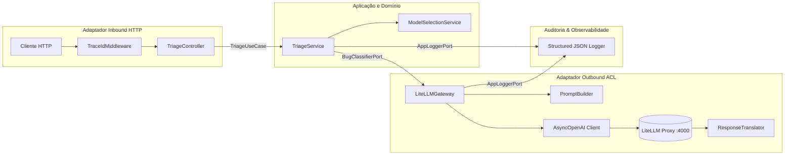

# Bug Triage API - Arquitetura Hexagonal & LiteLLM

API em **FastAPI** para triagem, categorização e diagnóstico automatizado de bugs e incidentes a partir de logs e mensagens de erro, estruturada rigorosamente no padrão de **Arquitetura Hexagonal (Ports and Adapters)** com **Camada Anticorrupção (ACL)** para integração com o [LiteLLM Proxy](https://docs.litellm.ai/).

---

## 🏛️ Arquitetura do Sistema

O projeto foi organizado para isolar a regra de negócio central de qualquer dependência externa (framework web, SDKs de IA, banco de dados e formatos de serialização):

```
app/
├── main.py                         # Composition Root (criação do app FastAPI, middlewares e handlers)
├── domain/                         # Núcleo puro (sem frameworks, regras e entidades de domínio)
│   ├── models.py                   # BugReport, BugClassification, TriageResult, TokenUsage, LLMCallMetrics
│   ├── enums.py                    # Complexity, Priority, ModelTier
│   └── exceptions.py               # DomainError, LLMUnavailableError, LLMTimeoutError, etc.
├── application/                    # Casos de uso e regras de orquestração
│   ├── ports/
│   │   ├── inbound.py              # TriageUseCase, HealthUseCase
│   │   └── outbound.py             # BugClassifierPort, LLMHealthPort, AppLoggerPort
│   └── services/
│       ├── triage_service.py       # Orquestrador do fluxo de triagem
│       ├── model_selection_service.py # Heurística de custo para seleção de tier
│       └── health_service.py       # Verificação de saúde da aplicação e upstream
├── adapters/                       # Adaptadores de entrada e saída
│   ├── inbound/http/               # Adaptador HTTP FastAPI
│   │   ├── controllers/
│   │   │   ├── triage_controller.py   # Endpoint POST /api/v1/triage
│   │   │   └── health_controller.py   # Endpoint GET /health
│   │   ├── schemas.py              # DTOs Pydantic (TriageRequest, TriageResponse, etc.)
│   │   ├── middleware.py           # Geração de Trace ID UUID4 e cabeçalho X-Trace-Id
│   │   ├── dependencies.py         # Injeção de dependências via FastAPI Depends
│   │   └── error_handlers.py       # Mapeamento de exceções de domínio em códigos HTTP (422, 502, 503, 504)
│   └── outbound/litellm/           # Camada Anticorrupção (ACL) do LiteLLM
│       ├── gateway.py              # Implementa BugClassifierPort e LLMHealthPort
│       ├── client.py               # Provedor do AsyncOpenAI e cliente HTTP
│       ├── prompt_builder.py       # Tradução: Domínio -> Mensagens do LLM
│       ├── response_translator.py  # Tradução e sanitização: JSON do LLM -> Domínio
│       ├── llm_schemas.py          # Contrato interno de resposta bruta do modelo
│       └── error_mapper.py         # Mapeia erros de SDK/rede para exceções de domínio
└── infrastructure/                 # Configurações e utilitários
    ├── config.py                   # Pydantic Settings e leitura de .env
    ├── container.py                # Wiring e injeção das dependências concretas
    └── logging/
        ├── context.py              # ContextVar assíncrono para propagação do trace_id
        └── logger_adapter.py       # Logger estruturado emitindo JSON por linha
```

---

## 🔄 Fluxo de Execução Hexagonal



### Principais Características da Implementação

1. **Camada Anticorrupção (ACL)**:
   - Nenhum tipo de SDK da OpenAI ou LiteLLM vaza para os serviços de aplicação ou domínio.
   - O `ResponseTranslator` limpa blocos markdown (````json ... ````), normaliza variações (como "media", "medium", "alto"), impõe limite máximo de **3 parágrafos** e extrai os tokens de forma segura.
   - O `ErrorMapper` converte timeouts e falhas de conexão em exceções sem acoplamento externo.
   - Suporte a retentativas transparentes (1 retry automático em caso de resposta inconsistente).
2. **Identificador de Rastreabilidade (Trace ID)**:
   - Para cada requisição recebida, um identificador `uuid4` único é gerado.
   - O `trace_id` é retornado no corpo da resposta e no cabeçalho HTTP `X-Trace-Id`.
   - É propagado assincronamente via `contextvars` e incluído em todas as linhas de log.
3. **Logger Estruturado em JSON**:
   - Registra cada passo (`request_received`, `tier_selected`, `llm_call_started`, `llm_call_completed`, `llm_response_parsed`, `request_completed`).
   - Registra o **modelo solicitado** (ex: `tier-high`) e o **modelo efetivo** retornado pelo proxy (ex: `gemini-2.5-flash`), permitindo auditar fallbacks.
   - Registra métricas de **latência em milissegundos** e contagem de tokens (`prompt_tokens`, `completion_tokens`, `total_tokens`).
   - **Privacidade garantida**: o conteúdo dos logs recebidos **nunca** é impresso nos logs, registrando apenas o tamanho (`content_length`).

---

## 🚀 Como Executar

### Pré-requisitos
- Python 3.11+ ou Docker & Docker Compose instalado.
- Chaves de API válidas (caso queira realizar chamadas com LLMs reais).

### 1. Configurar Variáveis de Ambiente

Copie o arquivo de exemplo e defina suas chaves:

```bash
# Windows PowerShell
Copy-Item .env.example .env

# Linux / MacOS
cp .env.example .env
```

Edite o `.env` com suas credenciais:
```ini
LITELLM_MASTER_KEY=sk-proxy-secret-1234
LITELLM_BASE_URL=http://localhost:4000
LITELLM_API_KEY=sk-proxy-secret-1234
OPENAI_API_KEY=sua_chave_openai
GEMINI_API_KEY=sua_chave_gemini
ANTHROPIC_API_KEY=sua_chave_anthropic
```

---

### 2. Execução via Docker Compose (Recomendado)

Sobe o LiteLLM Proxy e a API FastAPI em containers isolados:

```bash
docker compose up -d --build
```

- **FastAPI Triage API**: `http://localhost:8000`
- **Documentação Swagger**: `http://localhost:8000/docs`
- **LiteLLM Proxy**: `http://localhost:4000`

Para ver os logs estruturados em tempo real:
```bash
docker compose logs -f triage-api
```

---

### 3. Execução Localmente (com Virtualenv)

```bash
# Ativar o ambiente virtual (Windows)
.\venv\Scripts\Activate.ps1

# Ou no Linux/MacOS:
# source venv/bin/activate

# Instalar dependências
pip install -r requirements.txt

# Iniciar o servidor com recarregamento automático
uvicorn app.main:app --host 0.0.0.0 --port 8000 --reload
```

---

## 🧪 Testes Hands-on (Roteiro Prático)

Disponibilizamos um roteiro prático e automatizado para testar os endpoints da API de forma interativa. Consulte o guia detalhado em [`HANDS_ON.md`](HANDS_ON.md).

### Executando o Script Automatizado Hands-on

Com a aplicação rodando (local ou Docker), execute em outro terminal:

```bash
# Windows PowerShell
.\venv\Scripts\python.exe hands_on.py

# Linux / MacOS
python hands_on.py
```

O script dispara sequencialmente 5 cenários com payloads reais:
1. `GET /health`: Valida integridade da API e conectividade com o LiteLLM Proxy.
2. `POST /api/v1/triage` (**Bug Leve**): Bug simples de UI/CSS direcionado ao `tier-low`.
3. `POST /api/v1/triage` (**Bug Médio**): Log com mais de 300 caracteres direcionado ao `tier-medium`.
4. `POST /api/v1/triage` (**Bug Crítico**): Relato com termo crítico (`deadlock`) direcionado ao `tier-high`.
5. `POST /api/v1/triage` (**Validação 422**): Envio de timestamp inválido para conferir o tratamento de erros e propagação do `trace_id`.

---

## 📡 Contrato das APIs

### 1. Health Check
Verifica o status da API e a conectividade com o LiteLLM Proxy.

- **Método**: `GET`
- **Rota**: `/health`
- **Status 200 (Saudável)**:
```json
{
  "status": "ok",
  "dependencies": {
    "litellm": "up"
  },
  "trace_id": "8bb319c5-8f6b-4ea6-a796-7243aa52aeb8",
  "timestamp": "2026-10-10T19:00:00.000000+00:00"
}
```
- **Status 503 (Degradado - se o proxy estiver inacessível)**:
```json
{
  "status": "degraded",
  "dependencies": {
    "litellm": "down"
  },
  "trace_id": "9cc429a1-7e7b-4bb6-b806-8354ba63bfc9",
  "timestamp": "2026-10-10T19:00:00.000000+00:00"
}
```

---

### 2. Triagem e Categorização de Bug
Submete um log para análise inteligente e classificação técnica.

- **Método**: `POST`
- **Rota**: `/api/v1/triage`
- **Cabeçalho**: `Content-Type: application/json`

#### Payload de Requisição (Request)
```json
{
  "project_name": "checkout-system",
  "service": "payment-gateway",
  "timestamp": "2026-10-10T15:30:00-03:00",
  "content": "Fatal error: Thread starvation and deadlock detected in ConnectionPoolManager while acquiring locks for transaction ID 9821"
}
```

#### Payload de Resposta (Response - HTTP 200)
```json
{
  "trace_id": "f5835698-c913-4318-ae8d-192a6c019904",
  "complexity": "alta",
  "reasoning": "O erro evidencia um travamento crítico por deadlock e inanição de threads na gestão do pool de conexões sob concorrência.\n\nEsse cenário impede a liberação de recursos essenciais para as transações de pagamento, degradando a disponibilidade imediata do serviço.\n\nRecomenda-se a revisão da ordem de aquisição dos bloqueios, ajuste de timeout na obtenção de conexões e instrumentação de monitoramento de threads bloqueadas.",
  "priority": "alta",
  "timestamp": "2026-10-10T15:30:00-03:00"
}
```

#### Exemplos de Chamada via `curl`

**Exemplo 1: Triagem de Bug Crítico**
```bash
curl -X POST http://localhost:8000/api/v1/triage \
  -H "Content-Type: application/json" \
  -d '{
    "project_name": "checkout",
    "service": "orders-worker",
    "timestamp": "2026-10-10T15:45:00-03:00",
    "content": "java.lang.OutOfMemoryError: Java heap space due to suspected memory leak in session cache"
  }'
```

**Exemplo 2: Health Check**
```bash
curl -i http://localhost:8000/health
```

---

## 🧪 Como Rodar os Testes Automatizados (Pytest)

A suíte de testes com **pytest** cobre testes unitários de domínio, serviços, camada anticorrupção, formatador de logs e testes de integração com o `TestClient` do FastAPI:

### 1. Executando os testes unitários e de API (sem necessidade de chaves externas)

```bash
# Via ambiente virtual local
pytest -v

# Ou via Docker Compose
docker compose run --rm test-runner
```

### 2. Executando testes de integração real com o LiteLLM Proxy

Para testar a comunicação de ponta a ponta contra o LiteLLM Proxy ativo e chaves configuradas:

```bash
# Windows PowerShell
$env:RUN_INTEGRATION = "1"
pytest -v -m integration

# Linux / MacOS
RUN_INTEGRATION=1 pytest -v -m integration
```

---

## 📊 Formato dos Logs Estruturados

Cada ação gera uma linha JSON com `trace_id` e métricas completas de chamada do modelo:

```json
{"timestamp": "2026-10-10T19:05:25.960251+00:00", "level": "INFO", "logger": "bug_triage", "event": "request_received", "trace_id": "a93be9f2-2b36-4c42-83ee-8e6f1f44d189", "project_name": "checkout", "service": "payment-api", "content_length": 105}
{"timestamp": "2026-10-10T19:05:25.961312+00:00", "level": "INFO", "logger": "bug_triage", "event": "tier_selected", "trace_id": "a93be9f2-2b36-4c42-83ee-8e6f1f44d189", "tier": "tier-high", "reason": "Termo crítico detectado: 'deadlock'"}
{"timestamp": "2026-10-10T19:05:25.962045+00:00", "level": "INFO", "logger": "bug_triage", "event": "llm_call_started", "trace_id": "a93be9f2-2b36-4c42-83ee-8e6f1f44d189", "requested_model": "tier-high", "attempt": 1, "max_attempts": 2}
{"timestamp": "2026-10-10T19:05:26.115420+00:00", "level": "INFO", "logger": "bug_triage", "event": "llm_call_completed", "trace_id": "a93be9f2-2b36-4c42-83ee-8e6f1f44d189", "requested_model": "tier-high", "effective_model": "gemini-2.5-flash", "latency_ms": 153.37, "prompt_tokens": 142, "completion_tokens": 89, "total_tokens": 231, "attempt": 1}
{"timestamp": "2026-10-10T19:05:26.116010+00:00", "level": "INFO", "logger": "bug_triage", "event": "llm_response_parsed", "trace_id": "a93be9f2-2b36-4c42-83ee-8e6f1f44d189", "complexity": "alta", "priority": "alta", "paragraphs_count": 3}
{"timestamp": "2026-10-10T19:05:26.116892+00:00", "level": "INFO", "logger": "bug_triage", "event": "request_completed", "trace_id": "a93be9f2-2b36-4c42-83ee-8e6f1f44d189", "method": "POST", "path": "/api/v1/triage", "status_code": 200, "latency_ms": 156.64}
```
